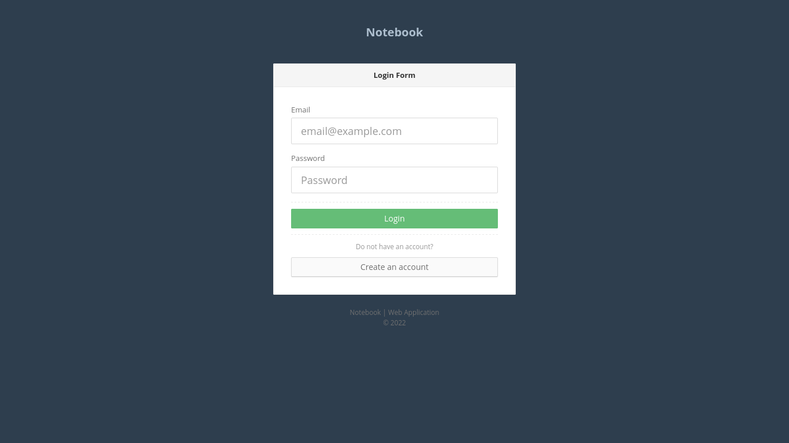
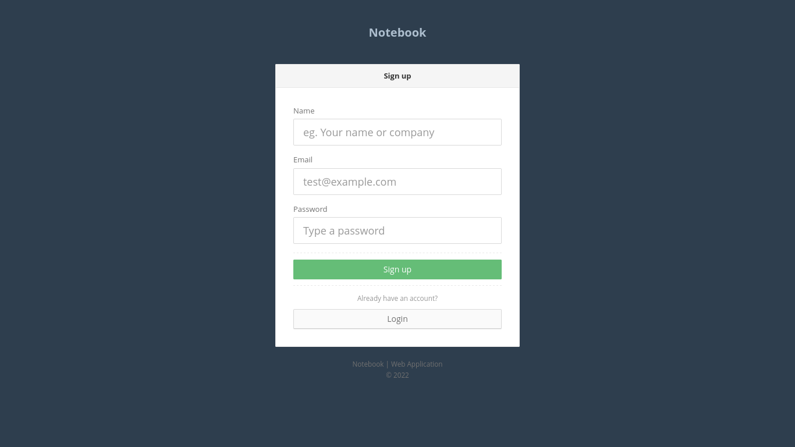
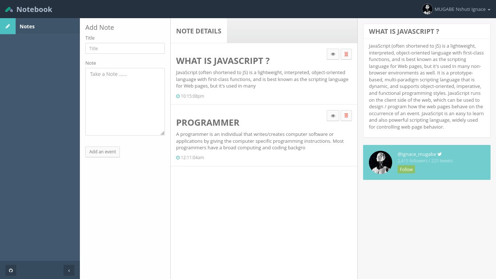

# NoteBook

>## <b> Tools used :</b>

>
>### <ul > Front-End :
>
>#### <li style="list-style-type: circle" > html</li>
>
>#### <li style="list-style-type: circle" > css:</li>
>
 >>                      UI Framework :
 >>     --------------------------------------------------
 >>[Bootstrap](https://getbootstrap.com/) 
 >>[animate.css](https://animate.style/)
>
>#### <li style="list-style-type: circle" > Javascript</li>
>
>>                    JavaScript Libraries:
>>     -------------------------------------------------
 >>[Modernizr](https://modernizr.com/)  
 >>[Underscore.js](https://underscorejs.org/)  
 >>[Moment.js](https://momentjs.com/)  
 >>[JQuery](https://jquery.com/)  
 >>[Backbone.js](https://backbonejs.org/) 
>
></ul>
>

>
>### <ul> Server Side || Back-End:
>
>#### <li style="list-style-type:circle">Apache Web Server</li>
>
>#### <li style="list-style-type:circle">Php programming language</li>
>
>#### <li style="list-style-type:circle">mysql</li>
>
 </ul></ul> 

## Project's View:
 
 
  

><h2> <b>The product are still in production ; feel free to give any idea or a suggestion.</b> </h2>
